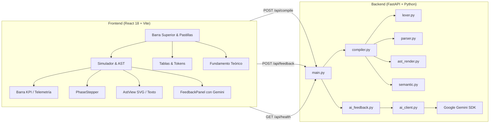

# Documento de Arquitectura y Justificación Técnica
## Simulador de Compilador Aritmético (Frontend + Backend + IA)

Este documento detalla la estructura, funcionamiento y justificación técnica de cada carpeta y módulo del proyecto **Simulador de Compilador Aritmético**, desarrollado para la materia de **Teoría de Compiladores** (Ingeniería de Sistemas).

---

## 1. Visión General del Sistema y Estructura Visual

El simulador adopta una arquitectura modular de tres pestañas y telemetría en tiempo real, inspirada en la plataforma de referencia académica ([simulador-dos.vercel.app](https://simulador-dos.vercel.app/)), adaptada a la teoría de lenguajes formales y compiladores (sin sección de retos):

1. **Header & Navegación en Pastillas (*Pill Nav*):**
   - **🚀 Simulador & AST:** Pipeline principal de análisis (fórmula, chips de escenarios, stepper, árbol AST gráfico y textual, tutor IA).
   - **📊 Tablas & Tokens:** Desglose léxico completo y tablas semánticas de símbolos y tipos.
   - **📖 Fundamento Teórico:** Guía académica interactiva (fases del compilador, gramática LL(1), tabla de precedencia y asociatividad izquierda).
2. **Barra de Métricas y Telemetría Rápida (*KPI Bar*):**
   - Monitoreo en vivo de métricas: tokens totales, profundidad del AST, direcciones semánticas asignadas, estado del pipeline y estado de conexión de Google Gemini.
3. **Paleta "Deep Forest & Sand":**
   - **Tema Oscuro:** Fondos en carbón cálido (`#131715`, `#1A201D`), acentos en verde salvia/menta (`#4ADE80`), operadores en ámbar tostado (`#FBBF24`), y errores en coral suave (`#F87171`).
   - **Tema Claro:** Fondos arena marfil y lino suave (`#F5F4EF`, `#FAF9F5`), acentos verde bosque (`#1B6A3B`), operadores caramelo tostado (`#B45309`), con contraste certificado WCAG AA (≥ 4.5:1).



---

## 2. Frontend: Estructura y Funcionamiento

Ruta: `compilador-aritmetico/frontend/`

Construido con **React 18**, **Vite** y **CSS plano** con variables en `src/styles.css`, sin librerías externas de UI ni frameworks CSS. Toda la lógica del compilador está delegada al backend; el frontend es estrictamente de presentación.

### 2.1. `frontend/src/` (Núcleo de la Aplicación)
- **`main.jsx`**: Punto de entrada de la aplicación React. Inicializa el Virtual DOM dentro del contenedor `#root` en modo estricto (`StrictMode`).
- **`App.jsx`**: Orquestador principal del estado de la interfaz de usuario:
  - Gestiona la navegación de pastillas superior (`simulador`, `teoria`).
  - Sincroniza la disponibilidad de la IA llamando a `GET /api/health` al montar el componente.
  - Almacena el resultado de compilación y calcula el estado dinámico del pipeline en el `PhaseStepper`.
  - Presenta el flujo secuencial completo en una sola vista: Entrada → Stepper → AST → Tabla de Tokens → Tablas Semánticas → Tutor Inteligente con IA.
  - Implementa accesibilidad con regiones `aria-live="polite"`.
- **`styles.css`**: Sistema de diseño con la paleta **Deep Forest & Sand**:
  - **Variables CSS**: Definidas para tema claro (`:root`) y tema oscuro (`[data-theme="dark"]`).
  - **Componentes modulares**: Tarjetas con bordes sutiles, badges redondeados, chips interactivos, y tablas monoespaciadas tabulares.
  - **Animaciones sutiles**: Entradas con fade y traslación escalonada que se desactivan automáticamente si el usuario tiene activado `prefers-reduced-motion`.

### 2.2. `frontend/src/components/` (Componentes Modulares)
- **`KpiBar.jsx`**: Franja de telemetría en tiempo real que calcula y presenta métricas clave de la fórmula: cantidad de tokens, profundidad del AST, direcciones semánticas creadas y estado del compilador y de Gemini.
- **`TheorySection.jsx`**: Módulo pedagógico interactivo y dinámico con 4 subsecciones:
  - *Las 6 Fases (Interactivo):* Pipeline completo de compiladores (Front-End: Léxico, Sintáctico, Semántico; Back-End: Código Intermedio/TAC, Optimización/Plegado de Constantes, Generación Objeto/x86_64). Incluye selector paso a paso, entradas/salidas formales, modelo matemático y transformación en vivo de la expresión `10 + 25 * 10 - 4` a lo largo de cada fase.
  - *Front-End vs Back-End:* Arquitectura de dos extremos conectada por el puente de Representación Intermedia (IR).
  - *Gramática LL(1) & Precedencia:* Producciones formales y playground con selector interactivo de fórmulas para ver cómo el parser descompone la jerarquía.
  - *Estructuras Transversales:* Tabla de Símbolos a lo largo de todas las fases y estrategias del Gestor de Errores (modo pánico, inserción).
- **`FormulaForm.jsx`**: Formulario de entrada con tipografía monoespaciada, conteo de caracteres (máximo 100) y **15 escenarios rápidos organizados en 5 categorías teóricas con filtrado interactivo**: Precedencia (`* > + -`), Asociatividad Izquierda (restas y divisiones en cadena), Paréntesis (múltiples y anidados), Errores Léxicos (`#`, `@`, `$`) y Errores Sintácticos (operadores consecutivos, desbalance de paréntesis, terminación abrupta).
- **`PhaseStepper.jsx`**: Indicador visual del pipeline: *Léxico → Sintáctico → Semántico*. Utiliza íconos SVG inline artesanales y no depende únicamente del color para comunicar el estado.
- **`TokensTable.jsx`**: Presenta la tabla de tokens (N.º, Tipo, Valor) con badges diferenciados para números y operadores.
- **`AstView.jsx`**: Visor de doble pestaña para el Análisis Sintáctico:
  - **Pestaña Gráfico:** Renderiza el AST como un diagrama **SVG nativo** calculado dinámicamente mediante recorrido in-order ($x = \text{índice} \times 70\text{ px}$, $y = \text{profundidad} \times 80\text{ px}$). Muestra operadores en círculos y números en rectángulos redondeados con aristas conectadas.
  - **Pestaña Texto:** Renderiza el árbol ASCII generado por el backend dentro de un bloque `<pre>` con botón de copiado al portapapeles.
- **`SymbolTables.jsx`**: Muestra las tablas semánticas generadas: Tabla de Símbolos (Símbolo y Dirección de memoria asignada) y Tabla de Tipos (Símbolo y Tipo de dato `entero`). Se ubican lado a lado en pantallas grandes y se apilan en móviles.
- **`ErrorPanel.jsx`**: Se activa cuando `ok: false`. Desglosa los errores recibidos y muestra la fórmula carácter por carácter, resaltando visualmente la posición exacta (base 1) donde ocurrió la falla léxica o sintáctica.
- **`FeedbackPanel.jsx`**: Panel de retroalimentación pedagógica. Muestra esqueletos animados (*shimmer skeleton*) mientras la IA responde, incluye botón de reintento en caso de falla y badge de "Respuesta guardada" cuando la respuesta provino de la caché LRU.
- **`ThemeToggle.jsx`**: Control accesible para alternar entre tema claro y tema oscuro con persistencia segura en `localStorage` y detección de `prefers-color-scheme`.

### 2.3. `frontend/src/services/` (Capa de Comunicación)
- **`api.js`**: Centraliza todas las llamadas HTTP (`compilar`, `obtenerSalud`, `pedirRetroalimentacion`). Aplica el proxy de Vite para redirigir peticiones a `http://localhost:8000` o conmuta al modo mock si la variable de entorno `VITE_USE_MOCK=true` está activa.

### 2.4. `frontend/src/mocks/` (Simulación para Desarrollo y Pruebas)
- **`compile.js`**: Mocks deterministas de compilación exitosa y error léxico idénticos al contrato del backend.
- **`health.js`**: Simulación del estado del backend con IA habilitada.
- **`feedback.js`**: Simula respuestas de retroalimentación pedagógica y caso de límite de cuota (`limite_de_uso`) al ingresar números con el dígito `9`.

---

## 3. Backend: Estructura y Funcionamiento

Ruta: `compilador-aritmetico/backend/`

Construido en **Python** utilizando **FastAPI**. Diseñado con separación estricta de responsabilidades bajo una arquitectura por capas.

### 3.1. `backend/app/` (Módulos de la Aplicación)

#### `lexer.py` (Fase 1: Analizador Léxico)
- Lee la cadena de texto carácter por carácter y clasifica los lexemas en tokens: `NÚMERO`, `OPERADOR` (`+`, `-`, `*`, `/`) o `PARÉNTESIS` (`(`, `)`).
- Cualquier símbolo no reconocido (por ejemplo `#`, `$`, `@`) genera un error léxico con su posición exacta (contada desde 1).

#### `parser.py` (Fase 2: Analizador Sintáctico)
- Implementa un **Parser Descendente Recursivo** para la gramática libre de contexto:
  $$\begin{aligned}
  \text{expr} &\rightarrow \text{term } ((\text{'+'} \mid \text{'-'}) \text{ term})^* \\
  \text{term} &\rightarrow \text{factor } ((\text{'*'} \mid \text{'/'}) \text{ factor})^* \\
  \text{factor} &\rightarrow \text{NÚMERO} \mid \text{'(' } \text{expr } \text{')'}
  \end{aligned}$$
- Aplica precedencia matemática estándar (`* /` > `+ -`) y **asociatividad izquierda**.
- Construye un Árbol de Sintaxis Abstracta (AST) binario.

#### `ast_render.py` (Representación ASCII del AST)
- Proyecta el AST en un diagrama textual multilínea utilizando barras `/` y `\` y espaciado proporcional.

#### `semantic.py` (Fase 3: Analizador Semántico)
- Recorre el AST en orden (*in-order*) y construye la **Tabla de Símbolos** (direcciones `dir_1`, `dir_2`...) y la **Tabla de Tipos** (`entero`).

#### `compiler.py` (Orquestador del Compilador)
- Coordina secuencialmente: `tokenizar()` $\rightarrow$ `parsear()` $\rightarrow$ `renderizar_ast()` $\rightarrow$ `analizar_semantica()`.
- Se detiene en la primera fase que presente fallas. Es 100 % determinista y desacoplado de la IA.

#### `ai_client.py` (Cliente Aislado de IA)
- Envoltorio delgado del SDK `google-genai`. Configurado para el modelo `gemini-3.1-flash-lite`.
- Aplica `AI_TIMEOUT_SECONDS=45` y `AI_MAX_TOKENS=800` para garantizar respuestas ricas y completas.

#### `ai_feedback.py` (Lógica Pedagógica y Protección)
- `construir_prompt(resultado)`: Prepara los prompts del sistema y usuario aislando los datos en `<formula>` y `<resultado>` sin `ast_texto`. Solicita un desglose pedagógico en 3 secciones estructuradas (Fases, Precedencia/AST y Fórmulas de práctica).
- **Caché LRU:** Almacena hasta 200 fórmulas en memoria devolviendo `desde_cache: true`.
- **Limitador de Tasa:** Restringe a 10 peticiones por minuto por IP con ventana deslizante.
- **Sanitización de Errores:** Nunca expone detalles internos ni credenciales en respuestas HTTP.

#### `main.py` (Puntos de Entrada HTTP)
- Expone `GET /api/health`, `POST /api/compile` y `POST /api/feedback`.

---

## 4. Pruebas Automatizadas

```text
pytest -q
17 passed in 1.24s
```
*(10 pruebas del núcleo + 7 pruebas de la capa de retroalimentación con IA).*

---

## 5. Despliegue en la Nube (Render.com - 100% Gratuito)

El proyecto cuenta con un archivo de infraestructura como código `render.yaml` (Render Blueprint) listo en la raíz:

1. **Backend Web Service (`compilador-backend`):**
   - Entorno: Python 3 con Uvicorn en `$PORT`.
   - Variables de entorno: `AI_API_KEY`, `AI_MODEL=gemini-3.1-flash-lite`, `AI_TIMEOUT_SECONDS=45`, `AI_MAX_TOKENS=800`.
2. **Frontend Static Site (`compilador-frontend`):**
   - Entorno: Node.js con `npm run build` apuntando a `dist/`.
   - Variable de entorno `VITE_API_URL` conectada automáticamente al host del backend.
   - Regla de reescritura SPA: `/*` $\rightarrow$ `/index.html` (nunca duerme, carga instantánea).
