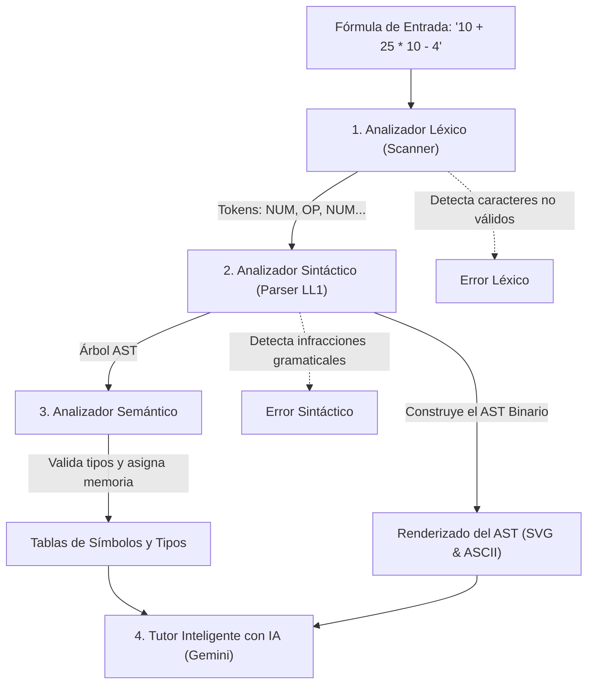

# ⚙️ Simulador de Compilador Aritmético con Tutor de IA

> **Plataforma didáctica e interactiva para el estudio y simulación de la Teoría de Compiladores.**  
> Diseñada para estudiantes y docentes de Ingeniería de Sistemas e Informática.

[](https://fastapi.tiangolo.com/)
[](https://www.python.org/)
[](https://react.dev/)
[](https://vitejs.dev/)
[](https://ai.google.dev/)
[](https://render.com/)
[-brightgreen?logo=pytest&logoColor=white)](https://docs.pytest.org/)

---

## 📌 1. ¿Qué hace este proyecto?

El **Simulador de Compilador Aritmético** es una aplicación *Full-Stack* que permite a los usuarios escribir o seleccionar fórmulas aritméticas (como `10 + 25 * 10 - 4`, `(10 + 25) * (10 - 4)` o `12 + 4 # 3`) y observar **en tiempo real y de manera visual e interactiva** cómo un compilador real procesa el código fuente paso a paso.

### Características Principales:
- 🔍 **Pipeline del Compilador Fase por Fase:** Inspección del análisis léxico, sintáctico y semántico.
- 🌳 **Árbol de Sintaxis Abstracta (AST) Dual:**
  - **Gráfico Interactivo:** Diagrama vectorial nativo SVG calculado dinámicamente mediante recorrido *in-order* con nodos diferenciados para operadores y números.
  - **Representación Textual:** Árbol ASCII estructurado con botón de copiado al portapapeles.
- 📊 **Tablas Semánticas y Léxicas en Vivo:** Tabla de tokens identificados (con posiciones y categorías) y Tablas de Símbolos (direcciones de memoria `dir_1`, `dir_2`...) y de Tipos (`entero`).
- 🤖 **Tutor Inteligente Asistido por IA (Google Gemini):** Explica pedagógicamente qué ocurrió en cada fase, justifica la jerarquía del AST (por qué los operadores de mayor precedencia como `*` o `/` forman subárboles profundos y cómo actúa la asociatividad por la izquierda), detecta errores con sugerencias de corrección y propone ejercicios de práctica.
- 📚 **Módulo de Fundamento Teórico Interactivo:** Recorrido interactivo por las **6 fases de un compilador industrial** (Front-End: Léxico, Sintáctico, Semántico; Back-End: Código Intermedio/TAC, Optimización/Plegado de Constantes, Generación Objeto x86_64).
- ⚡ **15 Escenarios Rápidos:** Casos de prueba listos para usar clasificados en *Precedencia*, *Asociatividad Izquierda*, *Paréntesis*, *Errores Léxicos* y *Errores Sintácticos*.
- 📱 **Diseño 100% Responsivo:** Adaptado para computadoras, tablets y teléfonos móviles (320px+).
- 🌓 **Tema Claro y Oscuro:** Paleta artesanal *Deep Forest & Sand* con persistencia en `localStorage`.

---

## 🛠️ 2. Tecnologías Utilizadas

### Frontend
- **React 18:** Arquitectura modular basada en componentes desacoplados y estados reactivos.
- **Vite:** Empaquetador ultrarrápido para desarrollo y compilación optimizada en producción.
- **CSS3 Moderno Puro:** Sin frameworks pesados (ni Tailwind ni Bootstrap); diseño personalizado con variables CSS, animaciones sutiles y soporte para modo oscuro y reducción de movimiento (`prefers-reduced-motion`).
- **SVG Dinámico:** Generación algorítmica de diagramas de árboles de sintaxis abstracta.

### Backend
- **Python 3.10+:** Lenguaje base del núcleo del compilador.
- **FastAPI:** Framework web moderno de alto rendimiento y tipado estático con validación automática mediante **Pydantic v2**.
- **Uvicorn:** Servidor ASGI para producción y desarrollo local.
- **Pytest & TestClient:** Suite de 17 pruebas unitarias y de integración continuas.

### Inteligencia Artificial
- **Google GenAI SDK (`google-genai`):** SDK oficial de Google para comunicarse con el modelo **Gemini 3.1 Flash Lite**.
- **Control de Cuota & Seguridad:** Limitador de tasa (*Rate Limiter* de 10 peticiones/min por IP), caché LRU en memoria (tope de 200 entradas) y sanitización estricta de trazas internas y secretos.

### Despliegue e Infraestructura
- **Render.com:** Despliegue automatizado mediante infraestructura como código con `render.yaml` (Render Blueprint):
  - *Backend:* Web Service en Python 3 con Uvicorn.
  - *Frontend:* Static Site servido a través de CDN global (apertura instantánea, sin cold start en la web).

---

## ⚙️ 3. ¿Cómo Funciona el Compilador?

El compilador sigue una arquitectura formal desacoplada en tres fases de análisis (Front-End):



### 1. Fase Léxica (`lexer.py`)
Lee la cadena de texto cruda y la divide en componentes léxicos válidos (**tokens**):
- Reconoce números enteros (`10`, `25`, `4`) y operadores aritméticos (`+`, `-`, `*`, `/`, `(`, `)`).
- Asigna a cada token su posición exacta (fila y columna).
- Si encuentra un carácter fuera del alfabeto permitido (como `@` o `#`), detiene el pipeline y reporta la posición exacta del error.

### 2. Fase Sintáctica (`parser.py`)
Implementa un **Parser Descendente Recursivo** para la Gramática Libre de Contexto LL(1) sin recursión por la izquierda:
$$\begin{aligned}
\text{expr} &\rightarrow \text{term } ((\text{'+'} \mid \text{'-'}) \text{ term})^* \\
\text{term} &\rightarrow \text{factor } ((\text{'*'} \mid \text{'/'}) \text{ factor})^* \\
\text{factor} &\rightarrow \text{NÚMERO} \mid \text{'(' } \text{expr } \text{')'}
\end{aligned}$$
- **Precedencia:** La multiplicación y la división se resuelven en el nivel `term` antes de ascender a `expr`.
- **Asociatividad por la Izquierda:** Expresiones como `10 - 4 - 2` se agrupan como `(10 - 4) - 2`, haciendo que el árbol crezca hacia su rama izquierda.
- **Construcción del AST:** Genera un árbol binario donde los nodos internos son operadores y las hojas son números.

### 3. Fase Semántica (`semantic.py`)
- Recorre el AST en orden (*in-order*) para asegurar la consistencia del tipo de dato (`entero`).
- Construye la **Tabla de Símbolos**, asignando una dirección virtual simulada (`dir_1`, `dir_2`...) a cada operando en memoria.
- Construye la **Tabla de Tipos**, certificando la compatibilidad estática de las operaciones.

### 4. Capa de Retroalimentación con IA (`ai_feedback.py` y `ai_client.py`)
- **Independencia absoluta:** La IA **nunca** calcula ni reemplaza una fase del compilador. El análisis es 100% determinista en Python.
- La IA recibe los datos estructurados en formato JSON y actúa como un tutor universitario:
  1. Explica qué realizó el pipeline en cada fase.
  2. Justifica la forma del AST citando el operador raíz y los subárboles profundos.
  3. Si hay error, explica la regla gramatical violada y la corrección paso a paso.
  4. Sugiere dos fórmulas similares para seguir practicando.

---

## 📂 4. Estructura del Repositorio

```text
compilador-aritmetico/
├── .gitignore                     # Exclusión de secretos, dependencias y caches
├── README.md                      # Documentación principal del proyecto
├── EXPLICACION_ARQUITECTURA.md   # Documento técnico detallado del sistema
├── render.yaml                    # Infraestructura como código (Render Blueprint)
│
├── backend/                       # API REST y Núcleo del Compilador (Python/FastAPI)
│   ├── app/
│   │   ├── __init__.py
│   │   ├── main.py                # Endpoints HTTP: GET /, GET /api/health, POST /api/compile, POST /api/feedback
│   │   ├── compiler.py            # Orquestador del pipeline determinista
│   │   ├── lexer.py               # Analizador léxico (Scanner)
│   │   ├── parser.py              # Analizador sintáctico LL(1) y generador del AST
│   │   ├── ast_render.py          # Renderizador textual ASCII del AST
│   │   ├── semantic.py            # Analizador semántico y tablas de símbolos/tipos
│   │   ├── ai_client.py           # Cliente aislado del SDK google-genai (Gemini)
│   │   └── ai_feedback.py         # Lógica del tutor, caché LRU y rate limiter
│   ├── tests/                     # 17 Pruebas unitarias automatizadas con Pytest
│   ├── .env.example               # Plantilla de variables de entorno
│   ├── requirements.txt           # Dependencias de Python
│   └── pytest.ini                 # Configuración del entorno de pruebas
│
└── frontend/                      # Interfaz de Usuario (React + Vite)
    ├── src/
    │   ├── components/
    │   │   ├── AstView.jsx        # Visor gráfico SVG interactivo y visor de texto ASCII
    │   │   ├── ErrorPanel.jsx     # Visualizador de errores léxicos/sintácticos resaltados
    │   │   ├── FeedbackPanel.jsx  # Panel con renderizador Markdown limpio del Tutor IA
    │   │   ├── FormulaForm.jsx    # Formulario con 15 escenarios rápidos categorizados
    │   │   ├── KpiBar.jsx         # Telemetría en tiempo real (tokens, profundidad, memoria)
    │   │   ├── PhaseStepper.jsx   # Indicador visual del pipeline (Léxico -> Sintáctico -> Semántico)
    │   │   ├── SymbolTables.jsx   # Tablas de Símbolos y Tipos de datos
    │   │   ├── TheorySection.jsx  # Módulo interactivo de las 6 fases y teoría de compiladores
    │   │   ├── TokensTable.jsx    # Tabla de componentes léxicos clasificados
    │   │   └── ThemeToggle.jsx    # Conmutador de tema claro / oscuro accesible
    │   ├── services/
    │   │   └── api.js             # Capa de comunicación HTTP con soporte dinámico para la nube
    │   ├── styles.css             # Sistema de diseño responsive Deep Forest & Sand
    │   ├── App.jsx                # Componente principal y gestión de estado
    │   └── main.jsx               # Punto de entrada de React
    ├── .env.example               # Plantilla de variables para el frontend
    ├── package.json               # Dependencias de Node.js
    └── vite.config.js             # Configuración de Vite y proxy local
```

---

## 🚀 5. Instalación y Ejecución Local

### Prerrequisitos
- Python ≥ 3.10
- Node.js ≥ 18
- Git

### 1. Clonar el Repositorio
```bash
git clone https://github.com/yisusnake024/compilador-aritmetico.git
cd compilador-aritmetico
```

### 2. Configurar y Ejecutar el Backend
```bash
cd backend

# Crear y activar entorno virtual
python -m venv venv
# En Windows:
venv\Scripts\activate
# En Linux/macOS:
source venv/bin/activate

# Instalar dependencias
pip install -r requirements.txt

# (Opcional) Configurar clave de IA de Gemini
copy .env.example .env    # En Linux/macOS: cp .env.example .env
# Edita el archivo .env y coloca tu AI_API_KEY

# Iniciar servidor FastAPI
uvicorn app.main:app --host 127.0.0.1 --port 8000 --reload
```
- API activa en: [http://localhost:8000](http://localhost:8000)
- Documentación Swagger interactiva: [http://localhost:8000/docs](http://localhost:8000/docs)

### 3. Configurar y Ejecutar el Frontend
En otra terminal:
```bash
cd compilador-aritmetico/frontend

# Instalar dependencias
npm install

# Iniciar servidor de desarrollo con Vite
npm run dev
```
- Aplicación web accesible en: [http://localhost:5173](http://localhost:5173)

---

## 🧪 6. Pruebas Automatizadas

El backend cuenta con una suite completa de pruebas unitarias que validan el comportamiento determinista del compilador y la seguridad de la capa de IA (con mocks que no realizan llamadas de red reales):

```bash
cd backend
pytest -q
```
**Resultado esperado:**
```text
.................                                                        [100%]
17 passed in 0.90s
```

---

## ☁️ 7. Despliegue en Render (100% Gratuito)

El proyecto incluye el archivo `render.yaml` para despliegue automatizado con un solo clic:

1. Ve a [Render.com](https://render.com) e inicia sesión con tu cuenta de GitHub.
2. Haz clic en **New +** $\rightarrow$ **Blueprint**.
3. Selecciona el repositorio `yisusnake024/compilador-aritmetico`.
4. Render configurará automáticamente:
   - **`compilador-backend`** (Web Service en Python con FastAPI).
   - **`compilador-frontend`** (Static Site en React/Vite enlazado a la CDN global).
5. En el campo **`AI_API_KEY`**, pega tu clave de Google Gemini.
6. Haz clic en **Apply**. ¡Listo!

---

## 📄 8. Licencia

Este proyecto fue desarrollado con fines educativos para la asignatura de **Teoría de Compiladores**, permitiendo la libre experimentación, estudio y ampliación pedagógica.
